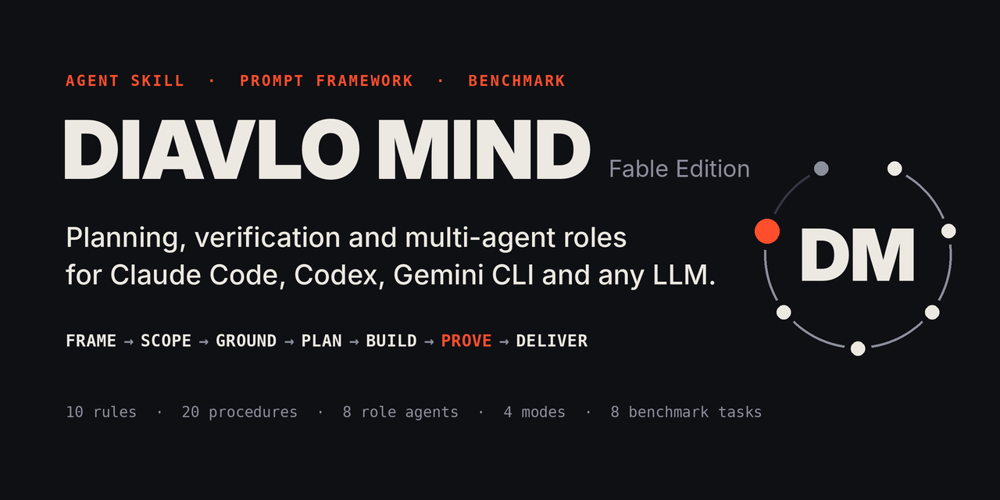

<p align="center">
  
</p>

# DIAVLO MIND — Agent Skill y sistema de prompts para Claude Code, Codex, Gemini CLI y cualquier LLM

[](https://github.com/Nikolai-coder/diavlo-mind/actions/workflows/validate.yml)


[English](README.md) · **Español**

Un método de trabajo para agentes de IA, empaquetado para aplicarlo a tu propio modelo con un comando. Hace que el modelo escriba los requisitos, elija cuánto esfuerzo merece la tarea, mire antes de actuar, pruebe lo que ha construido e informe con evidencia. Incluye una **Agent Skill**, un **plugin de Claude Code con ocho subagentes**, **cuatro prompts de sistema portables**, un **orquestador para varios proveedores** pensado para modelos que solo chatean, y un **benchmark** que mide qué cambia todo esto.

## Resumen ejecutivo

| | |
|---|---|
| **Qué es** | Una carpeta de instrucciones en texto plano y herramientas opcionales en Python: diez reglas, un bucle de siete pasos, cuatro modos de esfuerzo, veinte procedimientos paso a paso, ocho roles de agente y un estado de proyecto que sobrevive a la pérdida del contexto. |
| **Para quién** | Para quien usa agentes de programación o investigación (Claude Code, Codex, Gemini CLI, Antigravity) o llama a modelos por API, y está cansado de mensajes de «terminado» que luego no son verdad. |
| **Cómo se aplica** | Un comando por entorno, o pegar un archivo de prompt. Sin dependencias, sin compilación, sin descargas en ejecución. |
| **Qué cuesta** | En Claude Code: menos de 1.000 tokens siempre en contexto (las descripciones de la skill y de sus ocho agentes) y unos 3.000 más al invocar la skill. En el benchmark: un 28 % más de gasto en un modelo pequeño nuevo y un 4 % menos en uno antiguo. |
| **Qué se midió** | 96 ejecuciones del benchmark en dos modelos pequeños. En el antiguo, con el método se resolvieron **18 de 24** frente a **14 de 24** sin él, una diferencia que **no está establecida estadísticamente** (p = 0,22). En el nuevo, ambas configuraciones estaban en el techo y el método solo añadió coste. |
| **Qué no es** | No convierte un modelo en otro, no es un jailbreak y no copia los pesos, el prompt de sistema ni el razonamiento privado de ningún modelo. |

Todo lo que sigue está implementado en este repositorio o marcado como no verificado. Las cifras salen de ejecuciones que puedes repetir: [`evaluation/results/RESULTS.md`](evaluation/results/RESULTS.md) (en inglés, como el resto de la documentación técnica).

## Instalar en Claude Code, Codex, Gemini CLI o Antigravity

### Windows: un solo archivo, sin instalar nada antes

[](https://github.com/Nikolai-coder/diavlo-mind/blob/main/DIAVLO-MIND-Setup.bat)

Descarga [`DIAVLO-MIND-Setup.bat`](https://github.com/Nikolai-coder/diavlo-mind/blob/main/DIAVLO-MIND-Setup.bat) (botón *Download raw file* de esa página, o [enlace directo](https://raw.githubusercontent.com/Nikolai-coder/diavlo-mind/main/DIAVLO-MIND-Setup.bat) → *Guardar como*; también va adjunto a cada [release](https://github.com/Nikolai-coder/diavlo-mind/releases)) y haz doble clic. Si falta Python 3.9+, instala Python 3.12 para tu usuario (con winget o con el instalador firmado de python.org), descarga la última versión e instala DIAVLO MIND en cada herramienta de IA que encuentre. No necesita permisos de administrador; opciones como `--dry-run`, `--lang es` y `--uninstall` funcionan igual que en `install-all.bat`. Windows puede mostrar un aviso de SmartScreen al ser un `.bat` descargado: elige *Más información → Ejecutar de todas formas*, o léelo antes; es texto plano.

### Cualquier sistema, desde el repositorio

```bash
git clone https://github.com/Nikolai-coder/diavlo-mind
cd diavlo-mind

python scripts/install.py claude-code     # skill /diavlo-mind + 8 subagentes
python scripts/install.py codex           # Codex CLI y extensión de IDE: $diavlo-mind
python scripts/install.py gemini-cli      # Gemini CLI
python scripts/install.py antigravity     # Antigravity
```

Abre una sesión nueva y dale trabajo real, o llámala por su nombre: `/diavlo-mind arregla el test de exportación que falla y dime qué has verificado`. La skill responde en el idioma del usuario.

**Todas tus herramientas y «úsala siempre» en un solo paso.** En Windows, doble clic en `install-all.bat` (en otros sistemas, `python3 scripts/install_all.py`). Instala la skill en cada herramienta que encuentra y añade a las instrucciones globales de cada una una regla corta para que cargue DIAVLO MIND en cualquier tarea de varios pasos sin que se lo pidas. Ejecútalo antes con `--dry-run` para ver qué escribiría; `--uninstall` lo deshace. Detalles y límites en [INSTALL.md](INSTALL.md).

Claude Code también puede instalarla como plugin desde este repositorio:

```bash
claude plugin marketplace add Nikolai-coder/diavlo-mind
claude plugin install diavlo-mind@diavlo
```

Todas las opciones (instalación por proyecto, rutas de Windows, desinstalar) están en [INSTALL.md](INSTALL.md).

## Usarlo sin instalar nada

**Cualquier modelo de chat o asistente personalizado.** Pega un archivo de [`prompts/system/`](prompts/system/) en el prompt de sistema o en las instrucciones personalizadas:

| Archivo | Tamaño | Para qué |
|---|---|---|
| `diavlo-mind-micro.md` | menos de 1.500 caracteres | Campos pequeños de «instrucciones personalizadas» |
| `diavlo-mind-compact.md` | menos de 8.000 caracteres | GPT personalizados, instrucciones de proyecto, modelos pequeños |
| `diavlo-mind-standard.md` | unos 14.000 caracteres | Prompts de sistema por API, agentes con herramientas |
| `diavlo-mind-full.md` | unos 180.000 caracteres | Modelos de contexto grande, o como archivo de referencia adjunto |

**Cualquier API, sin entorno de agente.** El orquestador incluido planifica, ejecuta, lanza tu comando de pruebas, repara y revisa usando solo llamadas de chat:

```bash
export ANTHROPIC_API_KEY=...     # o OPENAI_API_KEY, GEMINI_API_KEY
python scripts/dm_orchestrate.py --task task.md --workspace ./project --mode standard \
    --executor anthropic:<model-id> --check-cmd "python -m pytest -q"
```

Proveedores: `anthropic`, `openai`, `openai-responses`, `gemini`, `compatible` (cualquier servidor que hable el formato de chat de OpenAI, local o alojado), `claude-cli` (tu Claude Code local, sin clave de API) y `cmd` (cualquier comando que lea un prompt por la entrada estándar).

## Cómo funciona

Todas las tareas recorren el mismo bucle. El modo decide cuánto pesa cada paso.

```
FRAME → SCOPE → GROUND → PLAN → BUILD → PROVE → DELIVER
```

(Encuadrar, dimensionar, comprobar el terreno, planificar, construir, demostrar, entregar.)

| Modo | Cuándo | Qué añade |
|---|---|---|
| **FAST** | Un paso claro, nada desconocido | Una comprobación y una línea que dice cuál fue |
| **STANDARD** | Unos pocos pasos o archivos, criterios claros | Lista de requisitos, plan corto, comprobaciones ejecutadas, informe de entrega |
| **DEEP** | Causa desconocida, cambio arriesgado o transversal | Investigación con evidencia, opciones y registro de decisión, tests, revisión independiente |
| **AUTONOMOUS** | Muchos archivos o etapas, más de una sesión | Estado persistente, grafo de tareas, puntos de control, informes de progreso, definición de terminado |

Las diez reglas, en corto: los requisitos son una lista numerada · mira antes de actuar · ajusta el esfuerzo · pregunta solo lo que bloquea · un cambio, una comprobación · demuestra, no afirmes · rompe los bucles tras dos fallos · no te salgas del alcance · escribe el estado · protege al usuario. El texto completo está al principio de [`SKILL.md`](SKILL.md) y tiene huella: no puede cambiar sin un motivo registrado.

Cada afirmación de un informe lleva un nivel, **VERIFIED**, **SOURCED**, **ASSUMED** o **UNKNOWN**, y una tarea acaba como **DONE**, **PARTIAL**, **BLOCKED** o **FAILED**. Lo que no se pudo ejecutar se escribe como NOT RUN.

## Qué hay dentro

| Ruta | Contenido |
|---|---|
| [`SKILL.md`](SKILL.md) | El núcleo: reglas, bucle, tabla de modos y una tabla que dice qué archivo leer en cada situación |
| [`workflows/modes/`](workflows/modes/) | Los cuatro modos, con condiciones de entrada, presupuestos y reglas de escalado |
| [`workflows/procedures/`](workflows/procedures/) | Veinte procedimientos, cada uno con Trigger, Inputs, Protocol, Tools, Outputs, Verification y Recovery: descomposición, planificación a largo plazo, ingeniería de software, uso de herramientas, investigación, arquitectura, depuración, coordinación multiagente, gestión de contexto, seguimiento de requisitos, control de calidad y nueve más |
| [`workflows/protocols/`](workflows/protocols/) | Paquetes de traspaso, orquestación, recuperación de sesión, modo híbrido con asesor y mejora guiada por evidencia |
| [`agents/`](agents/) | Ocho roles como subagentes de Claude Code: arquitecto, planificador, ejecutor, investigador, revisor, validador, optimizador y orquestador. El instalador los convierte para Codex y Gemini CLI |
| [`prompts/`](prompts/) | Cuatro niveles de prompt de sistema y diez plantillas de tarea |
| [`memory/`](memory/) | Nueve plantillas de estado de proyecto y tres esquemas JSON |
| [`scripts/`](scripts/) | Selector de modo, gestor de estado, paquetes, cliente de proveedores, orquestador, instalador, validador, generador de prompts, empaquetador, registro de mejoras y publicador en GitHub. Python 3.9+, solo biblioteca estándar |
| [`adapters/`](adapters/) | Una página por entorno: instalación, funciones, herramientas, configuración del modelo, modos y límites |
| [`evaluation/`](evaluation/) | Ocho tareas de benchmark con comprobaciones ocultas y soluciones de referencia, el arnés, la puntuación, la comparación pareada y los resultados publicados |
| [`examples/`](examples/) | Dos ejecuciones reales grabadas y dos recorridos con los scripts |
| [`ARCHITECTURE.md`](ARCHITECTURE.md) | Diseño, decisiones clave y la frontera entre implementado, verificado y propuesto |
| [`docs/`](docs/) | La página web del proyecto |

## Dónde funciona

| Entorno | Cómo | Estado a 10-11-2026 |
|---|---|---|
| **Claude Code** | Skill, plugin, ocho subagentes | Ejecutado: validado, instalado de tres formas y usado en una tarea real |
| **API de Claude** | Prompt de sistema, skill subida o el orquestador | Formato de la petición comprobado contra la documentación y un servidor simulado; no se llamó a la API real |
| **Codex y ChatGPT** | Skill en `.agents/skills`, agentes convertidos o un nivel de prompt | Escrito a partir de la documentación; no ejecutado |
| **API de OpenAI** | `instructions`, o el orquestador | Formato comprobado contra la documentación y un servidor simulado; no se llamó a la API real |
| **API de Gemini, Gemini CLI, Antigravity** | Carpetas de skills, agentes convertidos o el orquestador | Escrito a partir de la documentación; no ejecutado |
| **Modelos locales y otros** | Un nivel de prompt, o el orquestador con `compatible` o `cmd` | Proveedores cubiertos por tests; no se ejecutó ningún servidor de terceros |

Cada fila tiene su página en [`adapters/`](adapters/), que separa lo ejecutado de lo que solo se leyó.

## Resultados medidos

Ocho tareas (programación, depuración, arquitectura, investigación, creativa, proyecto largo, multiagente y recuperación de errores), tres repeticiones de cada una, con y sin el método, puntuadas con comprobaciones ocultas.

| Modelo | Sin | Con DIAVLO MIND | Coste con / sin | Prueba de signos pareada sobre tareas resueltas |
|---|---|---|---|---|
| `claude-haiku-4-5` | 14 de 24 resueltas | 18 de 24 resueltas | 0,96 | p = 0,22 (5 pares ganados, 1 perdido) |
| `claude-haiku-5-5` | 23 de 24 resueltas | 24 de 24 resueltas (23 en la primera puntuación) | 1,28 | no aplicable (1 par distinto) |

Cómo leerlo:

- En el modelo antiguo la dirección favorece al método, sobre todo en las tareas de depuración y de recuperación de errores. Con 24 pares todavía puede ser azar. Es un motivo para hacer más repeticiones, no un resultado que citar.
- En el modelo nuevo no quedaba nada que ganar en este conjunto de tareas, y el método costó un 28 % más.
- Las 96 ejecuciones acabaron declarando la tarea completa. El método bajó el número de ejecuciones fallidas en el modelo antiguo de 10 a 6. No consiguió que una sola ejecución fallida lo reconociera.
- Con el método, el modelo antiguo siguió sin dejar un traspaso escrito entre dos sesiones en 3 de 3 ejecuciones. Ese fallo y otros tres están registrados como abiertos en `evaluation/improvement/`.
- Cuatro comprobaciones ocultas resultaron más estrictas que el texto de su tarea y se corrigieron durante el piloto. Una ejecución cambió de resultado, a favor del método; se publican las dos cifras.
- No se ejecutó: un modelo de referencia más fuerte, ningún modelo que no sea Claude, ni los procedimientos bajo demanda y los subagentes de la skill (el benchmark aplica un único nivel de prompt).

Método: [`evaluation/README.md`](evaluation/README.md). Tablas completas, fallos y registro por ejecución: [`evaluation/results/RESULTS.md`](evaluation/results/RESULTS.md).

## Un modelo fuerte como asesor, uno pequeño como ejecutor

En el modo híbrido un modelo fuerte planifica y revisa, y uno más barato escribe. En Claude Code:

```bash
python scripts/install.py claude-code --executor-model haiku --advisor-model inherit
```

Fuera de Claude Code, con dos modelos cualesquiera:

```bash
python scripts/dm_orchestrate.py --task task.md --workspace ./project --mode standard \
    --advisor <provider>:<strong-model> --executor <provider>:<small-model> \
    --check-cmd "python -m unittest discover -s tests"
```

Hay una ejecución grabada en [`examples/02-fable-advisor-orchestrator/`](examples/02-fable-advisor-orchestrator/): tres llamadas a modelos, ninguna reparación, todos los tests pasando, y lo que costó cada rol. Sin asesor, los mismos roles los hace un solo modelo; [`workflows/protocols/fable-advisor.md`](workflows/protocols/fable-advisor.md) explica qué se pierde y cómo compensarlo.

## Proyectos largos que sobreviven a la pérdida del contexto

```bash
python scripts/dm_state.py init --objective "Ship the CSV importer" --done "python -m pytest -q passes"
python scripts/dm_state.py req add "Rows with a bad date are rejected"
python scripts/dm_state.py task add "Parse dates" --req R1 --accept "date tests pass"
python scripts/dm_state.py next                                   # qué toca ahora
python scripts/dm_state.py task set T1 --status doing
python scripts/dm_state.py task set T1 --status done --evidence "pytest -q: 14 passed"
python scripts/dm_state.py req set R1 --status met --evidence "tests/test_dates.py: 6 passed"
python scripts/dm_state.py resume                                 # tras una pausa: cómo están las cosas
python scripts/dm_state.py done-check                             # sale con 0 solo si todo está demostrado
```

La herramienta se niega a marcar una tarea como hecha sin evidencia, a empezarla antes que sus dependencias o a descartarla sin motivo. Una sesión completa, con los atajos rechazados, está en [`examples/03-autonomous-project-state/`](examples/03-autonomous-project-state/).

## Preguntas

**¿Esto hace que un modelo pequeño sea tan capaz como uno grande?**
No. Las instrucciones cambian lo que se le pide a un modelo, no lo que puede hacer. El benchmark de arriba es el tamaño real del efecto, incluidos los casos en que no hubo ninguno.

**¿Qué modelos pueden usarlo y en cuáles se midió?**
Cualquier modelo que siga instrucciones escritas: modelos Claude de cualquier tamaño, modelos GPT, modelos Gemini y modelos locales, por las vías de la tabla de arriba. Solo se midió en dos, `claude-haiku-4-5` y `claude-haiku-5-5`. Los modelos Claude más grandes, GPT y Gemini no se midieron. La segunda fila de los resultados sugiere que el efecto se reduce cuanto más fuerte es el modelo; es una hipótesis, no una medición.

**¿Es un prompt de sistema filtrado o un jailbreak?**
No. Está escrito desde cero como procedimientos observables: lee esto, ejecuta aquello, anótalo, informa con este formato. No pide a ningún modelo que revele su razonamiento privado ni intenta quitar ninguna protección.

**¿Funciona con ChatGPT o con GPT personalizados?**
Pega `prompts/system/diavlo-mind-compact.md` en el campo de instrucciones. Eso está escrito a partir de la documentación del producto y no lo hemos ejecutado; mira [`adapters/chatgpt.md`](adapters/chatgpt.md).

**¿Funciona con modelos locales?**
Con cualquier servidor que hable el formato de chat de OpenAI, usando `--executor compatible:<model>`, o con cualquier línea de comandos mediante `cmd`. No hemos ejecutado ningún servidor de terceros.

**¿Necesito Python?**
Solo para las herramientas opcionales. La skill y los prompts son texto plano.

**¿Cómo sé que mi copia está intacta?**
`python scripts/validate.py`, `python -m unittest discover -s tests` y `python evaluation/selftest.py`. Los mismos comandos están en el flujo de CI, `.github/workflows/validate.yml`.

**¿Por qué «Fable Edition»?**
El método se diseñó en una sesión configurada para el modelo `claude-fable-5-2`, y el modo híbrido se demostró con ese modelo como asesor. El nombre deja constancia de ese origen. El repositorio no contiene, reproduce ni desbloquea ese modelo.

## Estado

- **Implementado:** todo lo de la tabla «Qué hay dentro».
- **Verificado ejecutándolo:** la validación del repositorio, los tests unitarios, el autotest del benchmark y el empaquetado en Linux, macOS y Windows (CI, Python 3.13, y además Python 3.9 en Linux); la carga en Claude Code 2.1.322 en Linux; dos demostraciones reales; y el benchmark piloto de 96 ejecuciones.
- **No verificado:** llamadas reales a las API de Claude, OpenAI y Gemini; la instalación en Codex, Gemini CLI, Antigravity, ChatGPT y claude.ai; la instalación en Claude Code sobre Windows y macOS (los scripts y los tests pasan ahí, la instalación en sí no se probó).
- **Propuesto, no construido:** un bucle con llamadas a herramientas para los adaptadores de API, la puntuación con juez de la calidad de arquitectura y de la parte creativa, y hooks que hagan cumplir las reglas de forma mecánica.

El detalle, con la evidencia de cada línea, está en [`ARCHITECTURE.md`](ARCHITECTURE.md), sección 5.

## Contribuir

Se agradecen correcciones, adaptadores, tareas de benchmark y resultados de benchmark de otros modelos, también los que no muestren ningún efecto. Empieza por [CONTRIBUTING.md](CONTRIBUTING.md). Los cambios en cómo el método instruye a un modelo necesitan evidencia del benchmark, y los cambios en las diez reglas necesitan una aprobación registrada.

## Licencia y aviso

MIT, ver [LICENSE](LICENSE). Un proyecto de Diavlo, diseñado y construido con Claude en una sesión configurada para el modelo `claude-fable-5-2`.

DIAVLO MIND es un proyecto independiente. No está afiliado a Anthropic, OpenAI ni Google, ni cuenta con su aval o patrocinio. Claude, Claude Code, ChatGPT, Codex, Gemini y Antigravity son marcas de sus respectivos propietarios y se nombran aquí solo para indicar dónde se puede usar el método.
