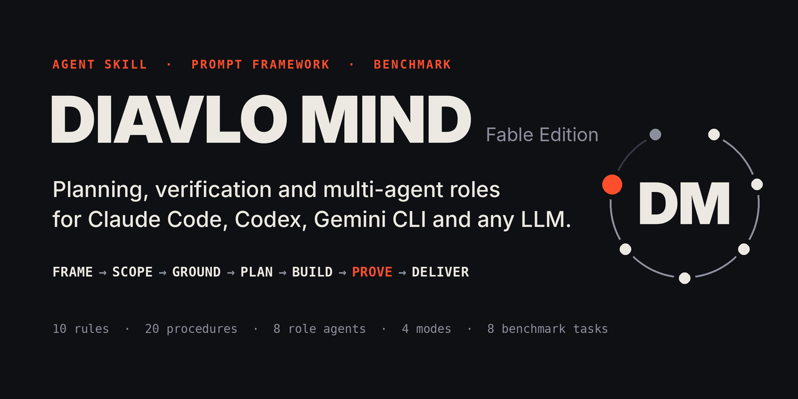

<p align="center">
  
</p>

# DIAVLO MIND — Agent Skill and prompt framework for Claude Code, Codex, Gemini CLI and any LLM

[](https://github.com/Nikolai-coder/diavlo-mind/actions/workflows/validate.yml)


**English** · [Español](README.es.md)

A working method for AI agents, packaged so you can apply it to your own model in one command. It makes a model write down the requirements, pick an effort level, look before it acts, test what it built and report with evidence. It ships as an **Agent Skill**, a **Claude Code plugin with eight subagents**, **four portable system prompts**, a **multi-provider orchestrator** for chat-only models, and a **benchmark** that measures what all of this changes.

## Executive summary

| | |
|---|---|
| **What it is** | A folder of plain-text instructions plus optional Python tools: ten rules, a seven-step loop, four effort modes, twenty step-by-step procedures, eight agent roles, and project state that survives a lost context. |
| **Who it is for** | People who run coding or research agents (Claude Code, Codex, Gemini CLI, Antigravity) or call models through an API, and are tired of "done" messages that turn out not to be true. |
| **How you apply it** | One command per environment, or paste one prompt file. No dependencies, no build step, nothing downloaded at run time. |
| **What it costs** | In Claude Code: under 1,000 tokens always in context (the descriptions of the skill and its eight agents) and roughly 3,000 more when the skill is invoked. In the benchmark: 28% more spend on a newer small model, 4% less on an older one. |
| **What was measured** | 96 benchmark runs on two small models. On the older one the framework arm solved **18 of 24** runs against **14 of 24** without it, a difference that is **not statistically established** (p = 0.22). On the newer one both were at the ceiling and the framework only added cost. |
| **What it is not** | Not a way to turn one model into another, not a jailbreak, and not a copy of any model's weights, system prompt or private reasoning. |

Everything below is either implemented in this repository or marked as not verified. The numbers come from runs you can repeat: [`evaluation/results/RESULTS.md`](evaluation/results/RESULTS.md).

## Install in Claude Code, Codex, Gemini CLI or Antigravity

```bash
git clone https://github.com/Nikolai-coder/diavlo-mind
cd diavlo-mind

python scripts/install.py claude-code     # skill /diavlo-mind + 8 role subagents
python scripts/install.py codex           # Codex CLI and IDE extension: $diavlo-mind
python scripts/install.py gemini-cli      # Gemini CLI
python scripts/install.py antigravity     # Antigravity
```

Then start a new session and give it real work, or call it by name: `/diavlo-mind fix the failing export test and tell me what you verified`.

**All the tools you have, and "use it by default", in one step.** On Windows double-click `install-all.bat` (elsewhere `python3 scripts/install_all.py`). It installs the skill in every tool it finds and adds a short rule to each tool's global instructions so it loads DIAVLO MIND on any multi-step task without being asked. Run it with `--dry-run` first to see what it would write; `--uninstall` undoes it. Details and limits in [INSTALL.md](INSTALL.md).

Claude Code can also install it as a plugin from this repository:

```bash
claude plugin marketplace add Nikolai-coder/diavlo-mind
claude plugin install diavlo-mind@diavlo
```

Every option, including project-scoped installs, Windows paths and uninstalling, is in [INSTALL.md](INSTALL.md).

## Use it without installing anything

**Any chat model or custom assistant.** Paste one file from [`prompts/system/`](prompts/system/) into the system prompt or custom instructions:

| File | Size | Use it for |
|---|---|---|
| `diavlo-mind-micro.md` | under 1,500 characters | Small "custom instructions" fields |
| `diavlo-mind-compact.md` | under 8,000 characters | Custom GPTs, project instructions, small models |
| `diavlo-mind-standard.md` | about 14,000 characters | API system prompts, agents with tools |
| `diavlo-mind-full.md` | about 180,000 characters | Large-context models, or an attached reference file |

**Any API, no agent host.** The bundled orchestrator plans, executes, runs your test command, repairs and reviews, using plain chat completions:

```bash
export ANTHROPIC_API_KEY=...     # or OPENAI_API_KEY, GEMINI_API_KEY
python scripts/dm_orchestrate.py --task task.md --workspace ./project --mode standard \
    --executor anthropic:<model-id> --check-cmd "python -m pytest -q"
```

Providers: `anthropic`, `openai`, `openai-responses`, `gemini`, `compatible` (any server that speaks the OpenAI chat format, local or hosted), `claude-cli` (your local Claude Code, no API key) and `cmd` (any command that reads a prompt on standard input).

## How it works

Every task runs the same loop. The mode decides how heavy each step is.

```
FRAME → SCOPE → GROUND → PLAN → BUILD → PROVE → DELIVER
```

| Mode | When | What it adds |
|---|---|---|
| **FAST** | One clear step, nothing unknown | One check and one line saying what it was |
| **STANDARD** | A few steps or files, clear criteria | Requirement list, short plan, executed checks, delivery report |
| **DEEP** | Unknown cause, risky or cross-cutting change | Investigation with evidence, options and a decision record, tests, independent review |
| **AUTONOMOUS** | Many files or stages, more than one session | Persistent state, task graph, checkpoints, progress reports, definition of done |

The ten rules, in short: requirements are a numbered list · look before you act · right-size the effort · ask only blocking questions · one change, one check · prove, don't claim · break loops after two failures · stay in scope · write state down · protect the user. The full text is at the top of [`SKILL.md`](SKILL.md) and is fingerprinted: it cannot change without a recorded reason.

Claims in a report carry a level, **VERIFIED**, **SOURCED**, **ASSUMED** or **UNKNOWN**, and a task ends as **DONE**, **PARTIAL**, **BLOCKED** or **FAILED**. Anything that could not be executed is written as NOT RUN.

## What is in the box

| Path | Content |
|---|---|
| [`SKILL.md`](SKILL.md) | The core: rules, loop, mode table, and a routing table that says which file to read in which situation |
| [`workflows/modes/`](workflows/modes/) | The four execution modes with entry conditions, budgets and escalation rules |
| [`workflows/procedures/`](workflows/procedures/) | Twenty procedures, each with Trigger, Inputs, Protocol, Tools, Outputs, Verification, Recovery: decomposition, long-horizon planning, software engineering, tool use, research, architecture, debugging, multi-agent coordination, context management, requirement tracking, quality assurance, and nine more |
| [`workflows/protocols/`](workflows/protocols/) | Handoff packets, orchestration, session recovery, the hybrid advisor mode, evidence-driven self-improvement |
| [`agents/`](agents/) | Eight roles as Claude Code subagents: architect, planner, executor, researcher, reviewer, validator, optimizer, orchestrator. The installer converts them for Codex and Gemini CLI |
| [`prompts/`](prompts/) | Four system-prompt tiers and ten task templates |
| [`memory/`](memory/) | Nine project-state templates and three JSON schemas |
| [`scripts/`](scripts/) | Mode selector, state manager, packet tools, provider client, orchestrator, installer, validator, prompt builder, packager, improvement log, GitHub publisher. Python 3.9+, standard library only |
| [`adapters/`](adapters/) | One page per environment: installation, features, tools, model configuration, modes, limits |
| [`evaluation/`](evaluation/) | Eight benchmark tasks with hidden checks and reference solutions, the harness, scoring, paired comparison, published results |
| [`examples/`](examples/) | Two recorded live runs and two script walkthroughs |
| [`ARCHITECTURE.md`](ARCHITECTURE.md) | Design, key decisions, and the line between implemented, verified and proposed |
| [`docs/`](docs/) | The project's web page |

## Where it works

| Environment | How | Status on 2026-11-10 |
|---|---|---|
| **Claude Code** | Skill, plugin, eight subagents | Executed: validated, installed three ways, and run on a live task |
| **Claude API** | System prompt, uploaded skill, or the orchestrator | Request format checked against the documentation and a local mock; live API not called |
| **Codex and ChatGPT** | Skill in `.agents/skills`, converted agents, or a prompt tier | Written from documentation; not executed |
| **OpenAI API** | `instructions`, or the orchestrator | Request format checked against the documentation and a local mock; live API not called |
| **Gemini API, Gemini CLI, Antigravity** | Skill folders, converted agents, or the orchestrator | Written from documentation; not executed |
| **Local and other models** | A prompt tier, or the orchestrator with `compatible` or `cmd` | Providers covered by tests; no third-party server was run |

Each row has its own page in [`adapters/`](adapters/) that separates what was executed from what was only read.

## Measured results

Eight tasks (programming, debugging, architecture, research, creative, long-term project, multi-agent, error recovery), three trials each, with and without the framework, scored by hidden checks.

| Model | Without | With DIAVLO MIND | Cost with / without | Paired sign test on task success |
|---|---|---|---|---|
| `claude-haiku-4-5` | 14 of 24 solved | 18 of 24 solved | 0.96 | p = 0.22 (5 pairs gained, 1 lost) |
| `claude-haiku-5-5` | 23 of 24 solved | 24 of 24 solved (23 as first scored) | 1.28 | not possible (1 differing pair) |

How to read it:

- On the older model the direction favours the framework, mostly on the debugging and error-recovery tasks. With 24 pairs this could still be chance. It is a reason to run more trials, not a result to quote.
- On the newer model there was nothing left to gain on this suite, and the framework cost 28% more.
- All 96 runs ended by claiming the task complete. The framework lowered the number of failed runs on the older model from 10 to 6. It did not make a single failing run admit it.
- With the framework, the older model still left no written handoff between two sessions in 3 of 3 runs. That failure and three others are recorded as open in `evaluation/improvement/`.
- Four hidden checks turned out stricter than their task text and were corrected during the pilot. One run changed outcome, in favour of the framework arm; both figures are published.
- Not run: a stronger reference model, any non-Claude model, and the skill's on-demand procedures and subagents (the benchmark applies one prompt tier).

Method: [`evaluation/README.md`](evaluation/README.md). Full tables, failures and per-run records: [`evaluation/results/RESULTS.md`](evaluation/results/RESULTS.md).

## Strong model as advisor, small model as worker

In the hybrid setup a strong model plans and reviews while a cheaper model writes. In Claude Code:

```bash
python scripts/install.py claude-code --executor-model haiku --advisor-model inherit
```

Outside Claude Code, with any two models:

```bash
python scripts/dm_orchestrate.py --task task.md --workspace ./project --mode standard \
    --advisor <provider>:<strong-model> --executor <provider>:<small-model> \
    --check-cmd "python -m unittest discover -s tests"
```

A recorded run of this is in [`examples/02-fable-advisor-orchestrator/`](examples/02-fable-advisor-orchestrator/): three model calls, no repairs, all tests passing, with what each role cost. Without an advisor the same roles run on one model; [`workflows/protocols/fable-advisor.md`](workflows/protocols/fable-advisor.md) lists what that loses and how to compensate.

## Long projects that survive a lost context

```bash
python scripts/dm_state.py init --objective "Ship the CSV importer" --done "python -m pytest -q passes"
python scripts/dm_state.py req add "Rows with a bad date are rejected"
python scripts/dm_state.py task add "Parse dates" --req R1 --accept "date tests pass"
python scripts/dm_state.py next                                   # what to do now
python scripts/dm_state.py task set T1 --status doing
python scripts/dm_state.py task set T1 --status done --evidence "pytest -q: 14 passed"
python scripts/dm_state.py req set R1 --status met --evidence "tests/test_dates.py: 6 passed"
python scripts/dm_state.py resume                                 # after a break: where things stand
python scripts/dm_state.py done-check                             # exits 0 only when everything is proven
```

The tool refuses to mark a task done without evidence, to start one before its dependencies, or to drop one without a reason. A full session, including the refused shortcuts, is in [`examples/03-autonomous-project-state/`](examples/03-autonomous-project-state/).

## Questions

**Does this make a small model as capable as a large one?**
No. Instructions change what a model is asked to do, not what it can do. The benchmark above is the honest size of the effect, including the cases where there was none.

**Which models can use it, and on which was it measured?**
Any model that follows written instructions: Claude models of every size, GPT models, Gemini models and local models, through the routes in the table above. It was measured on two only, `claude-haiku-4-5` and `claude-haiku-5-5`. Larger Claude models, GPT and Gemini models were not measured. The second row of the results suggests that the effect shrinks as the model gets stronger; that is a hypothesis, not a measurement.

**Is it a leaked system prompt or a jailbreak?**
No. It was written from scratch as observable procedures: read this, run that, write this down, report in this form. It does not ask a model to reveal private reasoning and does not try to remove any safeguard.

**Does it work with ChatGPT or custom GPTs?**
Paste `prompts/system/diavlo-mind-compact.md` into the instructions field. That was written from the product documentation and was not run by us; see [`adapters/chatgpt.md`](adapters/chatgpt.md).

**Does it work with local models?**
Through any server that speaks the OpenAI chat format, with `--executor compatible:<model>`, or through any command line with `cmd`. No third-party server was run by us.

**Do I need Python?**
Only for the optional tools. The skill and the prompts are plain text.

**How do I know my copy is intact?**
`python scripts/validate.py`, `python -m unittest discover -s tests` and `python evaluation/selftest.py`. The same commands are in the CI workflow, `.github/workflows/validate.yml`.

**Why "Fable Edition"?**
The framework was designed in a session configured for the model `claude-fable-5-2`, and the hybrid mode was demonstrated with that model as advisor. The name records that origin. The repository does not contain, reproduce or unlock that model.

## Status

- **Implemented:** everything in the table "What is in the box".
- **Verified by execution:** repository validation, the unit tests, the benchmark self-test and packaging on Linux, macOS and Windows (CI, Python 3.13, plus Python 3.9 on Linux); loading in Claude Code 2.1.322 on Linux; two live demonstrations; and the 96-run pilot benchmark.
- **Not verified:** live calls to the Claude, OpenAI and Gemini APIs; installation in Codex, Gemini CLI, Antigravity, ChatGPT and claude.ai; installing into Claude Code on Windows and macOS (the scripts and tests pass there, the install itself was not tried).
- **Proposed, not built:** a tool-calling loop for the API adapters, judged scoring of architecture and creative quality, and hooks that enforce the rules mechanically.

The full account, with the evidence for each line, is in [`ARCHITECTURE.md`](ARCHITECTURE.md), section 5.

## Contributing

Corrections, adapters, benchmark tasks and benchmark results from other models are welcome, including results that show no effect. Start with [CONTRIBUTING.md](CONTRIBUTING.md). Changes to how the framework instructs a model need benchmark evidence, and changes to the ten rules need a recorded approval.

## Licence and disclaimer

MIT, see [LICENSE](LICENSE). A project by Diavlo, designed and built with Claude in a session configured for the model `claude-fable-5-2`.

DIAVLO MIND is an independent project. It is not affiliated with, endorsed by or sponsored by Anthropic, OpenAI or Google. Claude, Claude Code, ChatGPT, Codex, Gemini and Antigravity are trademarks of their respective owners and are named here only to say where the framework can be used.
